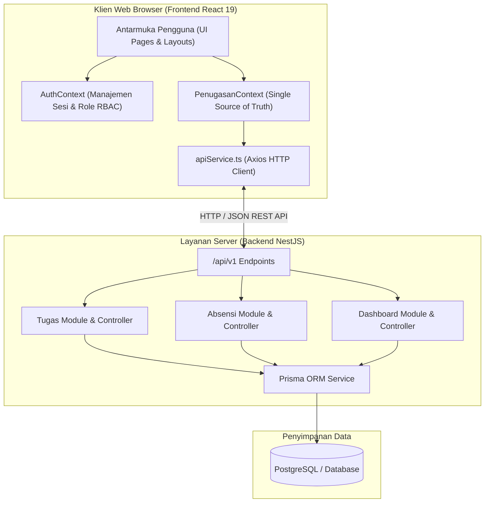

# Technical Architecture & Tech Stack (ARCHITECTURE.md)
## SIM-Penugasan

---

### 1. Gambaran Umum Arsitektur (*High-Level Architecture*)

Sistem dibangun menggunakan pola **Client-Server terpisah (Decoupled Architecture)**:
* **Frontend**: Single Page Application (SPA) berbasis **React 19**, **TypeScript**, **Vite**, dan **Tailwind CSS**.
* **Backend**: RESTful API berbasis **NestJS 11** dan **Prisma ORM** yang mengelola data tugas, absensi, dan autentikasi.



---

### 2. Struktur Direktori Proyek (*Directory Structure*)

```text
kp-26-sim-penugasan/
├── backend/                        # Backend Server (NestJS)
│   ├── src/
│   │   ├── modules/
│   │   │   ├── absensi/            # Controller & Service Absensi
│   │   │   ├── dashboard/          # Controller Ringkasan Statistik
│   │   │   └── tugas/              # Controller & Service CRUD Tugas & Status
│   │   ├── prisma.service.ts       # Jembatan Prisma ORM
│   │   ├── app.module.ts           # Root Module NestJS
│   │   └── main.ts                 # Entrypoint server (Port 3001)
│   ├── prisma/
│   │   └── schema.prisma           # Skema Basis Data Prisma
│   └── package.json
│
├── frontend/                       # Frontend Web (React 19 + Vite)
│   ├── src/
│   │   ├── api/
│   │   │   ├── apiService.ts       # Integrasi pemanggilan endpoint backend
│   │   │   └── axiosInstance.ts    # Konfigurasi dasar Axios
│   │   ├── components/
│   │   │   ├── admin/              # Sub-komponen, form, tab & modal khusus Admin
│   │   │   ├── approval/           # Modal konfirmasi & editor template khusus Approval
│   │   │   ├── super-admin/        # Modal penugasan & ajuan khusus Super Admin
│   │   │   ├── user/               # Navbar/sidebar User, modal draft ajuan & tab presensi
│   │   │   ├── penugasan/          # Komponen penugasan bersama (filter pemetaan, dll.)
│   │   │   ├── calendar/           # Kalender penugasan
│   │   │   ├── map/                # Peta sebaran penugasan (Leaflet)
│   │   │   └── ui/                 # Komponen UI bersama (A4WordEditorCanvas, CetakSuratTugasModal, DocxPreviewViewer, KalenderRekapDinasModal, DashboardAjuanDetailModal, AdminSidebarMenu, AdminTopNavbar)
│   │   ├── utils/                  # Helper murni (suratHtmlHelpers, signaturePadHelpers, penugasanNormalizers, userDraftAjuanHelpers, docxImport/Export)
│   │   ├── context/
│   │   │   ├── AuthContext.tsx      # Otentikasi & Penyimpanan role pengguna
│   │   │   └── PenugasanContext.tsx # State terpusat penugasan & workflow
│   │   ├── data/
│   │   │   └── dummyData.ts        # Basis data pegawai master (8 personil)
│   │   ├── layouts/
│   │   │   ├── AdminLayout.tsx     # Shell layout Admin & Super Admin
│   │   │   ├── AuthLayout.tsx      # Shell layout halaman autentikasi
│   │   │   └── UserLayout.tsx      # Shell layout Pegawai & Approval
│   │   ├── pages/
│   │   │   ├── admin/              # Portal Admin Operasional
│   │   │   ├── approval/           # Portal Pimpinan (Persetujuan & Riwayat)
│   │   │   ├── auth/               # Halaman Login & Lupa Password
│   │   │   ├── shared/             # Halaman bersama lintas role (Dashboard Admin/SA, Arsip, Monitoring, Rekap)
│   │   │   ├── super-admin/        # Portal Master Super Admin
│   │   │   └── user/               # Portal Pegawai (Tugas, Absensi, Cuti)
│   │   ├── routes/
│   │   │   ├── AppRoutes.tsx       # Root Router
│   │   │   ├── ProtectedRoute.tsx  # Guard hak akses berbasis role
│   │   │   ├── AdminRoutes.tsx
│   │   │   ├── ApprovalRoutes.tsx
│   │   │   ├── SuperAdminRoutes.tsx
│   │   │   └── UserRoutes.tsx
│   │   ├── types/
│   │   │   └── index.ts            # Definisi Type & Interface TypeScript
│   │   ├── index.css               # Styling global & @media print A4
│   │   └── main.tsx                # Entrypoint React
│   └── package.json
│
├── PRD.md                          # Dokumen Persyaratan Produk
├── DESIGN.md                       # Panduan Desain & Antarmuka
├── ARCHITECTURE.md                 # Dokumen Arsitektur Sistem
├── DATABASE.md                     # Skema & Relasi Basis Data
├── AGENTS.md                       # Standar Penulisan Kode & Panduan Kolaborasi
├── TASKS.md                        # Roadmap & Rincian Tugas Pengerjaan
└── README.md                       # Ringkasan Proyek & Panduan Setup
```

---

### 3. Alur Manajemen Data (*State Management & Data Flow*)

1. **Autentikasi & RBAC (`AuthContext.tsx`)**:
   * Menyimpan sesi akun yang sedang aktif, role (`SUPER_ADMIN`, `ADMIN`, `APPROVAL`, `USER`), unit kerja, serta data NIP/Jabatan.
   * `ProtectedRoute.tsx` memeriksa apakah user memiliki hak akses terhadap rute yang dituju; jika tidak, otomatis dialihkan ke dashboard perannya masing-masing.

2. **Sinkronisasi Tugas (`PenugasanContext.tsx`)**:
   * Menjadi satu-satunya sumber data tugas dinas (*Single Source of Truth*).
   * Ketika pegawai membuat draf tugas di portal User $\rightarrow$ data disimpan via API $\rightarrow$ state otomatis tersinkronisasi $\rightarrow$ tugas langsung muncul di portal Approval pimpinan.
   * Ketika pimpinan mengklik *Setujui* atau *Tolak* $\rightarrow$ status tugas (`SURAT_TERBIT` atau `DITOLAK`) diperbarui via API $\rightarrow$ status di layar User langsung terbit dan pin lokasi di peta Admin langsung aktif.

3. **Komunikasi API & Safe Fallback (`apiService.ts`)**:
   * Menggunakan instance Axios dengan base URL `/api`.
   * Dilengkapi mekanisme *fallback* otomatis: jika backend offline/dalam tahap pemeliharaan, sistem tetap berjalan mulus menggunakan cadangan memori lokal sehingga antarmuka tidak *crash*.

