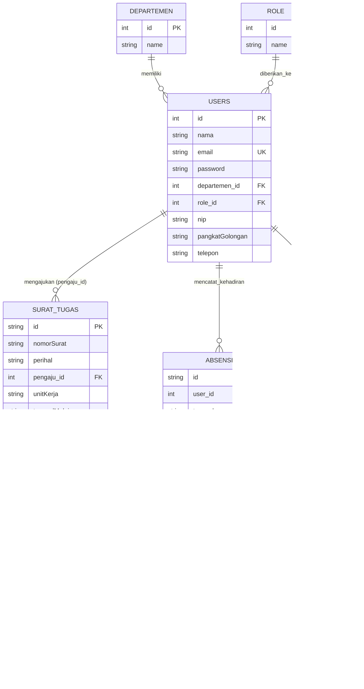

# Database Schema & Data Models (DATABASE.md)
## SIM-Penugasan

Dokumen ini menjelaskan rancangan skema basis data, struktur tabel, relasi antar-entitas, dan aturan hak akses data (*Data Access Rules*).

---

### 1. Diagram Relasi Entitas (*Entity Relationship Diagram*)

---

### 2. Rincian Tabel Utama (*Table Specifications*)

#### A. Tabel `users`
Menyimpan kredensial login, data identitas kepegawaian resmi, dan penugasan departemen/unit kerja.
* `id` (INT, Primary Key, Auto Increment)
* `nama` (VARCHAR 100, Not Null): Nama lengkap pegawai beserta gelar.
* `email` (VARCHAR 100, Unique, Not Null): Email kedinasan pegawai.
* `password` (VARCHAR 255, Not Null): Password terenkripsi bcrypt.
* `departemen_id` (INT, Foreign Key $\rightarrow$ `departemen.id`): Unit kerja asal pegawai.
* `role_id` (INT, Foreign Key $\rightarrow$ `role.id`): ID hak akses pengguna.
* `nip` (VARCHAR 30): Nomor Induk Pegawai resmi standar 18 digit.
* `pangkatGolongan` (VARCHAR 50): Contoh: `Pembina / IV/a`, `Penata Tk. I / III/d`.
* `telepon` (VARCHAR 20): Nomor kontak WhatsApp/telepon dinas.

#### B. Tabel `surat_tugas`
Menyimpan draf permohonan, naskah dinas, koordinat penugasan, dan status persetujuan.
* `id` (VARCHAR 36, UUID, Primary Key)
* `nomorSurat` (VARCHAR 100, Not Null): Nomor SPT resmi (contoh: `094/0112/Fastingkom/2026`).
* `perihal` (VARCHAR 255, Not Null): Judul atau agenda kegiatan penugasan dinas luar.
* `pengaju_id` (INT, Foreign Key $\rightarrow$ `users.id`): Akun pegawai/admin yang membuat usulan.
* `unitKerja` (VARCHAR 50, Not Null): Unit pengusul (`RBI`, `Fastingkom`, `Kepeg`, `PM`).
* `tanggalMulai` (VARCHAR 20, Not Null): Tanggal mulai pelaksanaan tugas (`YYYY-MM-DD`).
* `tanggalSelesai` (VARCHAR 20, Not Null): Tanggal akhir pelaksanaan tugas (`YYYY-MM-DD`).
* `lokasiPenugasan` (VARCHAR 255, Not Null): Nama kota, kabupaten, dan provinsi tujuan.
* `koordinatLat` & `koordinatLng` (FLOAT, Nullable): Koordinat lintang dan bujur untuk pemetaan GIS Leaflet.
* `deskripsi` (TEXT): Rincian agenda atau dasar surat penugasan.
* `dokumenDraftText` (TEXT, Nullable): Naskah naskah dinas yang diketik langsung di browser.
* `status` (VARCHAR 50, Not Null): Status penugasan:
  * `DRAFT`: Draf usulan baru dibuat.
  * `VERIFIKASI_SUBBAGIAN`: Sedang ditelaah di tingkat subbagian.
  * `PERSETUJUAN_PIMPINAN`: Menunggu persetujuan Kepala Dinas / Pejabat Penyetuju.
  * `SURAT_TERBIT`: Tugas disetujui resmi dan siap dicetak SPT-nya.
  * `DITOLAK`: Ajuan ditolak pimpinan dengan catatan khusus.
* `fileDraftUrl` & `fileFixUrl` (VARCHAR 255): Tautan dokumen lampiran pendukung atau laporan tugas selesai.

#### C. Tabel `surat_tugas_pegawai` (Pivot Relasi Many-to-Many)
Menghubungkan satu surat penugasan dengan satu atau lebih personil pelaksana dinas.
* `id` (VARCHAR 36, UUID, Primary Key)
* `surat_tugas_id` (VARCHAR 36, Foreign Key $\rightarrow$ `surat_tugas.id`, On Delete Cascade)
* `user_id` (INT, Foreign Key $\rightarrow$ `users.id`, On Delete Cascade)

#### D. Tabel `absensi`
Mencatat presensi kehadiran harian pegawai, integrasi lokasi dinas luar, serta kalkulasi tunjangan.
* `id` (VARCHAR 36, UUID, Primary Key)
* `user_id` (INT, Foreign Key $\rightarrow$ `users.id`)
* `tanggal` (VARCHAR 20): Tanggal presensi (`YYYY-MM-DD`).
* `jamMasuk` (VARCHAR 10): Jam presensi masuk (`HH:mm:ss`).
* `lokasiPresensiMasuk` (VARCHAR 255): Lokasi absensi masuk (Kantor / Luar Kantor / Lapangan).
* `jamKeluar` (VARCHAR 10, Nullable): Jam presensi pulang.
* `lokasiPresensiKeluar` (VARCHAR 255, Nullable): Lokasi absensi pulang.
* `status` (VARCHAR 50): Nilai: `HADIR`, `TERLAMBAT`, `IZIN`, `SAKIT`, `ALFA`.
* `keterangan` (TEXT, Nullable): Keterangan izin, dokter sakit, atau konfirmasi atasan.

---

### 3. Aturan Keamanan & Akses Data (*Security & Access Scoping*)

1. **Role User (Pegawai)**:
   * Hanya dapat membaca riwayat penugasan miliknya sendiri atau tugas di mana ia terdaftar sebagai pelaksana.
   * Hanya dapat mengajukan draf baru dan memodifikasi draf yang masih berstatus `DRAFT`.
2. **Role Approval (Pimpinan)**:
   * Dapat melihat seluruh ajuan tugas yang masuk ke unit kerjanya atau lintas unit yang membutuhkan disposisi pimpinan.
   * Memiliki wewenang mutasi status ke `SURAT_TERBIT` atau `DITOLAK`.
3. **Role Admin**:
   * Dapat mengelola penugasan operasional unit dan memvalidasi berkas laporan.
4. **Role Super Admin**:
   * Memiliki akses penuh membaca, mengubah, dan menghapus seluruh tabel di tingkat basis data.

